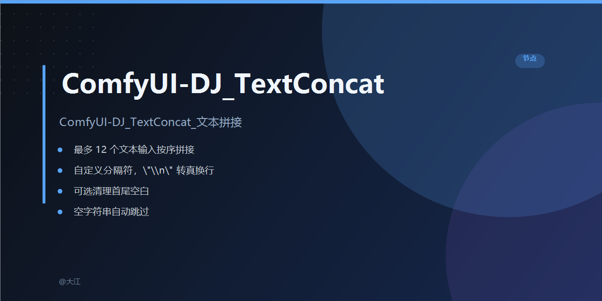

# ComfyUI-DJ_TextConcat（文本拼接）使用说明书

## 这个节点是干什么的？

把**最多 12 个文本输入**按顺序拼成一个字符串。

典型场景：
- 把几段提示词（正向 / 负向 / 风格词 / 画质词）拼成一条完整 prompt
- 把日期、编号、备注等小片段拼成一句话
- 配合「字符串替换」「文本加载」等节点做流水线加工

## 节点位置

右键菜单 → **DJ / TextConcat / ComfyUI-DJ_TextConcat**

## 输入

| 输入名 | 类型 | 必填 | 说明 |
|---|---|---|---|
| 分隔符 | STRING（手填） | ✅ | 各段之间的连接符。默认空（直接连）。要换行就填 `\n`（两个字符：反斜杠 + n），节点会自动转成真换行；想加空格就填 ` `，想加逗号就填 `,` 等 |
| 清理首尾空白 | 是 / 否 | ✅ | 「是」= 每段先去掉开头和结尾的空格、换行再拼；「否」= 原样拼。默认「否」 |
| 文本1 ~ 文本12 | STRING（接线） | ❌ | 最多 12 个文本输入口，**接几个用几个**，没接的自动忽略，不会报错 |

> 注意：文本1~12 是**接线口**（forceInput），不能直接在节点上手填文字，要接别的节点的输出口。

## 输出

| 输出名 | 类型 | 说明 |
|---|---|---|
| 文本 | STRING | 拼接后的完整字符串 |

## 拼接规则（按顺序执行）

1. 把 12 个口里**实际接了线的**文本取出来；
2. 如果「清理首尾空白 = 是」，先把每段两端的空格/换行去掉；
3. **空字符串直接跳过**（不占位、不产生多余的分隔符）；
4. 用「分隔符」把剩下的段按 文本1 → 文本12 的顺序连起来。

## 举例

假设：
- 文本1 接 `"你好"`，文本2 接 `"世界"`，其余没接
- 分隔符 = `，`，清理首尾空白 = 否

输出：`你好，世界`

如果再加：
- 文本3 接 `""`（空），文本4 接 `"！"`

输出还是：`你好，世界！`（空的文本3 被跳过，不会出现 `你好，世界，！` 这种多逗号的情况）

## 常见问题

**Q：分隔符填 `\n` 没换行？**
A：确认你填的是两个字符「反斜杠 + n」，不是直接按回车。节点只认字面量 `\n`，会帮你转成真换行。

**Q：拼出来开头/结尾多了空格？**
A：把「清理首尾空白」改成「是」。

**Q：12 个口不够用？**
A：把多个 TextConcatenateDJ 节点串起来——第一个的输出接进第二个的某个文本口，继续拼。

**Q：改了节点没生效？**
A：本插件只有后端 `.py`，没有前端 JS。改完代码需要**重启 ComfyUI**；工作流里只是重新连线/改参数，直接运行就行，不用刷新。
